# DAINS · Data Insight Studio

  

**对话式统计分析工作台** — 上传一份 Excel / CSV，AI Agent 负责统计、建模与成文报告；全过程 Python 沙箱真实执行，每一段结论都附上生成它的代码。

> DAINS 为**非开源项目**，本仓库不包含源代码，仅作为产品介绍门面：三分钟了解背景、能力、架构与隐私立场，并引导您完成在线端测试。

| 在线体验 | 产品文档 | 图文演示 | 反馈入口 |
|---|---|---|---|
| [dains.cn](https://dains.cn) | [wiki.dains.cn](https://wiki.dains.cn) | [公测招募文](https://blog.csdn.net/Tigflanker/article/details/169844744) | [系统 → 问卷收集](#反馈与问卷) |

### 30 秒速览

| 项 | 说明 |
|---|---|
| 定位 | 对话式统计分析工作台（能力预览版 Beta） |
| 核心机制 | Agent 生成 Python 代码 → 沙箱执行 → 结果成文；结论坚持**结论 · 大纲 · 依据 · 代码实证**四位一体 |
| 资产沉淀 | 分析步骤 → 工具；统计口径 → 习惯；结论 → 看板 |
| 数据留存 | 文件系统 / PostgreSQL / Redis 三处，注销全清；注册账号信息另存平台库 |
| 模型接入 | 单一 LLM Router，国产模型为主，兼容 OpenAI 标准协议；本地 Ollama 可组成内网闭环 |
| 开放时间 | 每天 8:30 – 23:10（测试期经 Cloudflare 中转，高峰可能卡顿） |
| 上手路径 | 注册 → 上传 → 宽表透视 → 分析提问 → 导出 / 沉淀 |

**目录**：[能力一览](#能力一览) · [5 分钟上手](#5-分钟上手) · [截图](#截图) · [架构与流程](#架构与流程) · [大模型接入](#大模型接入) · [数据与合规](#数据与合规) · [当前状态](#当前状态) · [路线图](#路线图) · [反馈与问卷](#反馈与问卷)

---

## 能力一览

九大板块构成完整蓝图：**源数 → 宽表 → 分析 → 建模 → 工具 → 习惯 → 看板 → 调度 → 系统**。状态图例：✅ 已上线　🟡 建设中　⬜ 规划中

| # | 板块 | 区域 | 状态 | 一句话 |
|---|---|---|---|---|
| 1 | 源数 | 数据区 | ✅ | 上传、类型白名单、N 级目录树、焦点勾选跨板块联动；数据库 / API 扩展规划中 |
| 2 | 宽表 | 数据区 | ✅ | 上传即透视：类型识别、缺失画像、15 箱直方图、Top10 取值，全量精确统计，可导出 HTML 统计面板 |
| 3 | 分析 | 产出区 | ✅ | AI 问数：普通 / 检索式提交、HITL 意图确认、四层支撑报告、HTML 与 PDF 导出 |
| 4 | 建模 | 产出区 | ✅ | 两阶段 AutoML：Stage1 特征消融 → 圈定特征 → Stage2 Optuna 搜索；LightGBM 全自动调参 |
| 5 | 工具 | 产出区 | ✅ | 自然语言描述 → 「输入 → 处理 → 输出」标准化工具；换同构数据一键复用、零大模型消耗 |
| 6 | 习惯 | 产出区 | 🟡 | 规划用于沉淀统计口径与个人偏好，未来分析自动召回；当前能力尚未完成 |
| 7 | 看板 | 监控区 | ✅ | 看板 Agent 一句话建板，19 种图表 + 6 种统计表、拖拽画布、只读链接免登录分享 |
| 8 | 调度 | 监控区 | ⬜ | 未来为系统注入「心跳」，承担周期任务与看板自动更新；当前尚未上线 |
| 9 | 系统 | 配置区 | ✅ | 账户 / 配置 / 问卷：功能计划板、问卷收集、欢迎与使用文档 |

---

## 5 分钟上手

1. **上传 → 宽表**：在【源数】上传 CSV / Excel（也可用自带 Titanic 样例），切到【宽表】，类型识别、缺失率与分布特征已算好，无需写代码。
2. **提问 → 分析**：切【分析】选焦点数据集，白话提问（如「哪些字段对 Survived 影响最大？」）；Agent 弹出**意图确认卡（HITL）**补全分析对象、目标变量与输出形式。
3. **读答案 → 四位一体**：角标点击即展开该段结论**实际执行的 Python 代码**与 AI 解释；可导出 HTML（溯源）/ PDF（交付）。
4. **沉淀 → 工具**：把跑通的步骤存为**多步骤工具**，换一份焦点数据集原样复用；偏好与口径的自动召回随【习惯】建成后提供。
5. **稳态 → 看板**：让**看板 Agent** 组装模块化看板（拖拽布局、19 种图表），生成只读链接分享；内容自动更新能力随【调度】上线后提供。

> 小贴士：任意主功能页面**按住 Alt（macOS 为 Option）约 2 秒**，显示当前阶段各要素的功能说明。

---

## 截图

<b>📷 展开全部截图（7 张）</b>

| 主界面 · 分析智能体 | 宽表 · 上传即透视 |
|---|---|
| 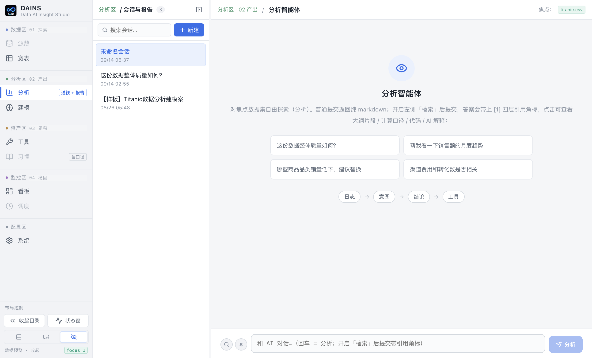 | 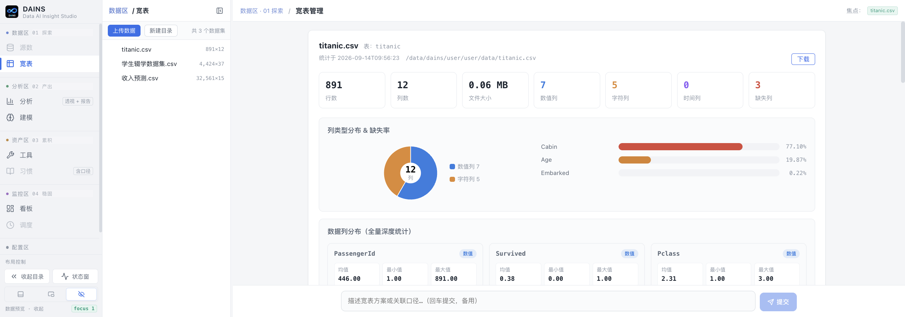 |

| 分析 · HITL 意图确认 | 四位一体 · 代码实证 |
|---|---|
| 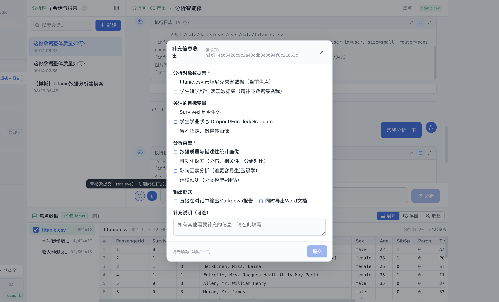 | 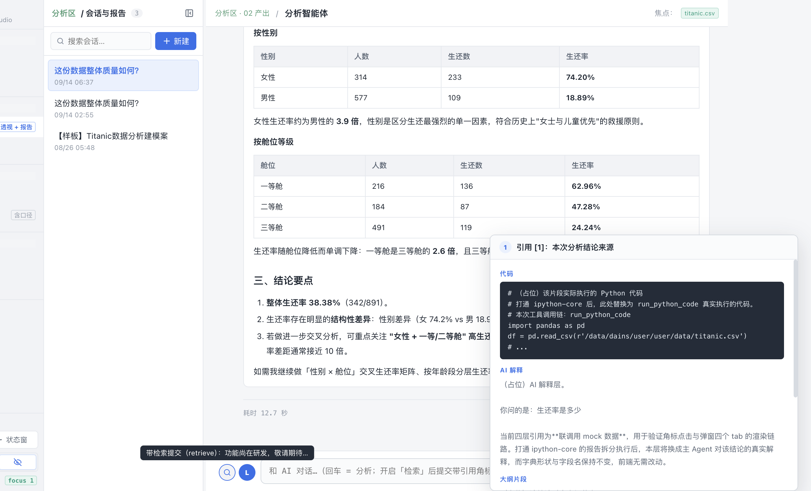 |

| 建模 · 两阶段参数盘 | 看板 · 拖拽画布 |
|---|---|
| 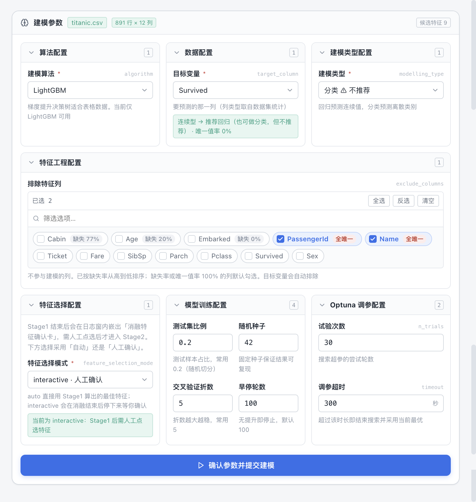 | 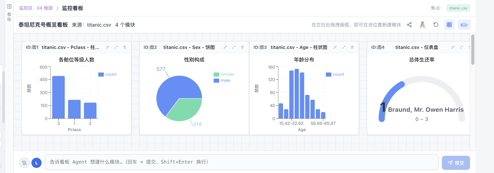 |

| 工具库 | |
|---|---|
| 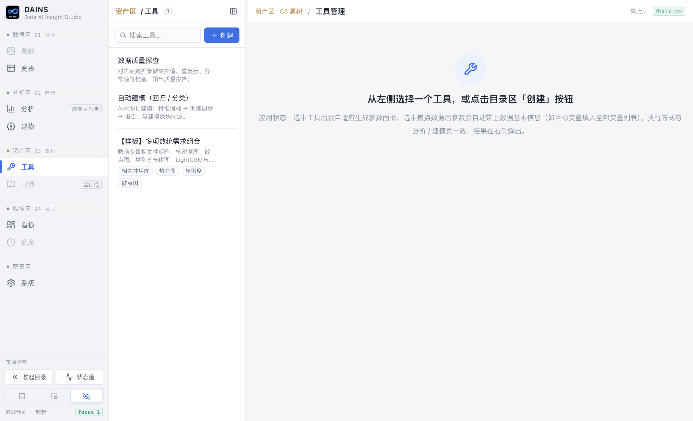 | |

---

## 架构与流程

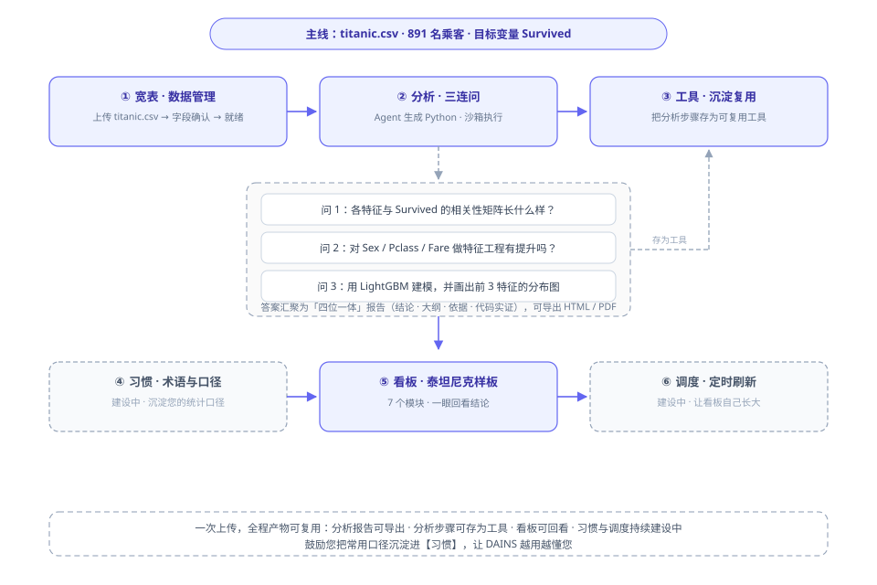

一次上传，全程产物可复用：**分析报告可导出 · 分析步骤可存为工具 · 看板可回看**。

服务端采用 Docker Compose 架构部署，后端服务由 supervisor 统一管控，按职责划分为 API 服务、AI Agent、Python 沙箱、任务调度等单元；接入层由 Cloudflare Tunnel + NGINX 承担。配合 Ollama 本地模型即可组成全链路内网闭环；**面向用户的私有化交付包仍在路线图上**。

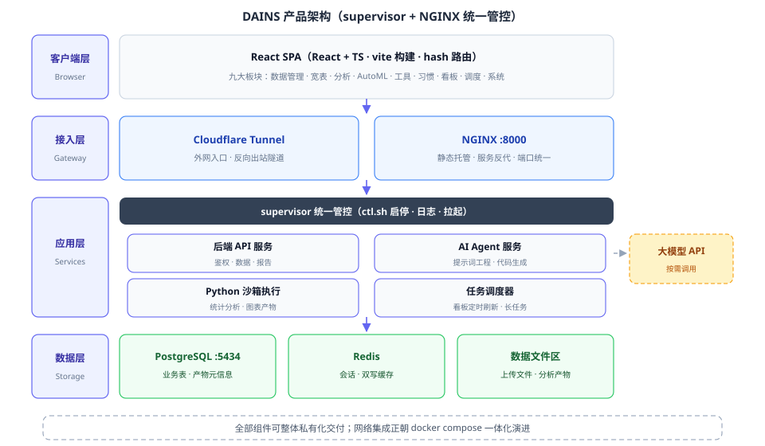

**网络链路**：浏览器 → Cloudflare Tunnel → NGINX → 后端服务 → 大模型 API。服务仅监听本机端口，隧道由内向外出站建连，**服务器无需暴露任何入站端口**；大模型 API Key 加密存放于服务端，仅在您发起分析时发送必要的统计摘要与提示词。

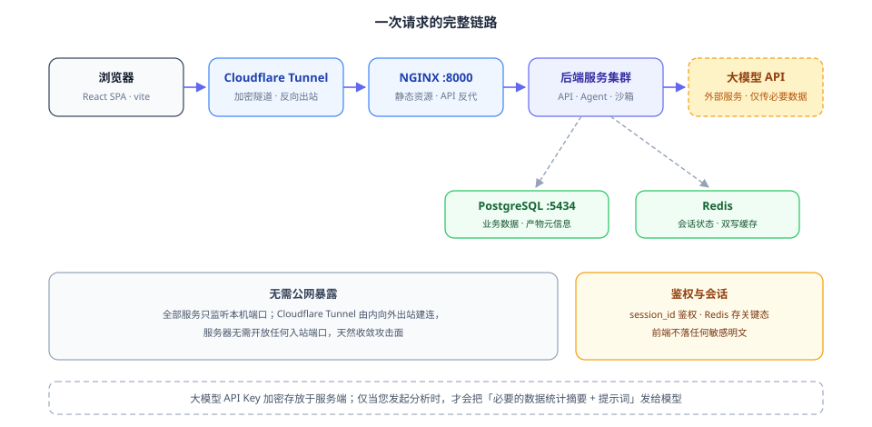

| 层 | 技术选型 |
|---|---|
| 客户端 | React + TypeScript + Vite |
| 接入层 | Cloudflare Tunnel + NGINX |
| 应用层 | Python Flask 多服务（supervisor 管控）|
| AI 层 | 多模型路由（国产模型为主）+ Python 沙箱真实执行 |
| 数据层 | 文件系统 + PostgreSQL + Redis |
| 建模 | LightGBM + Optuna（两阶段 AutoML）|

---

## 大模型接入

DAINS 不绑定任何一家大模型，所有推理请求统一经过一层 LLM Router，按能力、成本与时延分发到最合适的服务。当前**以国产模型为主**：

| 类别 | 内容 |
|---|---|
| 云端（国产为主） | DeepSeek、通义千问、Kimi、智谱、火山方舟等，以及 SiliconFlow（硅基流动）、OpenRouter 等聚合中转 |
| 本地 | Ollama（计划加入 Xinference），数据不出机器、零 API 费用、离线可用 |
| 接入标准 | **OpenAI 兼容协议**（Anthropic 协议适配中）。此处「OpenAI / Anthropic」指**接口标准，而非特定厂商**——就像 Type-C 只是接口规范，国内许多模型服务尚未来得及单独开发适配，只要符合该标准即可接入试用 |

模型可以更换、可以混用、也可以降级到更经济的方案，而分析流程、工具与口径资产不受影响。选 Ollama 路线，整条链路——上传、解析、统计、建模、成文——全部在您的机器内闭环，数据无需发往公网，零 token 费用、离线可用。

---

## 数据与合规

从上传到删除，数据的每个停留点都**可见、可查、可清**。

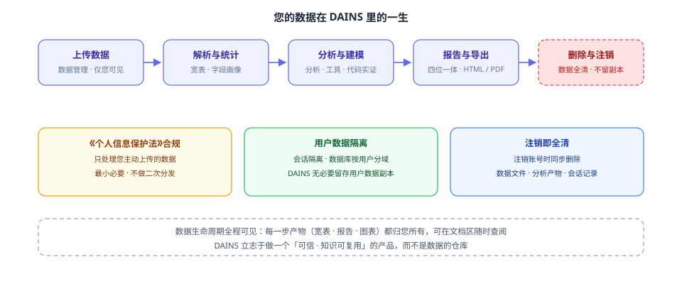

**您的数据只暂存于三处**：文件系统（上传文件与分析产物）、PostgreSQL（业务元信息）、Redis（会话状态），除此之外无任何副本。注册所需的账号信息（用户名、邮箱、加密后的登录凭据）保存在平台数据库中，仅用于登录与账号管理。

> **⚠️ 数据隐私承诺**
>
> DAINS 遵循《个人信息保护法》等法规处理数据，且无必要留存用户任何数据——分析在您的数据上就地完成，产物归您所有，**唯一例外是问卷收集信息，仅用于产品改进**。
>
> 注销账号即触发**全清**：注册信息（账号及关联加密凭据）、数据文件、分析产物、会话记录一并删除，不留残余。

> **⚠️ 看板分享提示**：看板生成的只读分享链接为**免登录访问**，任何持有链接者均可查看该看板内容；分享前请确认看板中不含敏感数据。

> **🔵 AI 生成内容标识**：平台按《人工智能生成合成内容标识办法》对 AI 生成的文本、图表与报告添加生成标识；您在对外使用导出报告时，请同步留意所在场景的标识要求。

> **🔵 协议与政策**：《用户协议》与《隐私政策》整理中，将在注册页提供并需勾选同意，其中会明确数据留存范围、注销清除流程与双方权责。

---

## 当前状态

| 项 | 说明 |
|---|---|
| 版本 | 能力预览版（Beta，公测期），以线上方式提供服务；产品级私有化交付（Windows 桌面版 / Docker Compose）是未来明确的落地方向 |
| 开放时间 | 每天 8:30 – 23:10；测试阶段本地服务器部署 + Cloudflare 中转，**高峰时段可能卡顿甚至短时无法访问**；正式交付版本无需跨网传输，不存在此类卡顿问题 |
| 测试密钥 | 无自有 API Key 者可**限量领取**（评论或私信博主）。密钥为公共共享资源，已设置用量与频率限制，仅限公测体验，请勿用于生产任务或批量调用 |
| 服务连续性 | 能力预览版按「现状」提供，不承诺服务连续性；**重要分析结果请及时导出留存** |
| 结论使用 | AI 生成的统计结论仅供决策参考，正式用途请以人工复核后的结果为准 |
| 数据建议 | 建议先用系统自带 Titanic 样例或**脱敏数据**体验；上传真实业务数据前请先阅读上文隐私承诺与看板分享提示 |

*本文档最后更新：2026-11-13*

---

## 路线图

| 方向 | 内容 |
|---|---|
| **看板与自动化** | 图表体系完善、调度板块、定时跑批与异动叙事播报 |
| **数据接入与宽表** | 多表关联、NL2SQL 与上游数据接入、轻量 ETL |
| **分析 Agent 深化** | 长任务拆解执行、口径召回、交叉验证与大模型审核机制、R 语言支持 |
| **工具与资产生态** | 工具市场与方案模板包、统一资产抽象（工具 / 口径 / 看板 / 调度）|
| **产品化交付** | Docker Compose 私有化、Windows 打包分发、License 授权体系 |

> 看板 Agent、只读分享与导出已上线，不再列为规划项。逐条可追溯的进度见系统内【产品功能计划板】。

---

## 反馈与问卷

**2027 年前，DAINS 不考虑任何盈利，最关心的是用户问卷。**

DAINS 由独立开发者以 OPC（One Person Company，一人公司）方式从零打造，产研链条上难免存在不够成熟之处：部分延展方向受限于个人精力尚未展开，实际使用中也可能遇到各类缺陷（Bug）。无论建议还是问题，都欢迎通过【系统】→【问卷收集】告诉我们，每一条都会被认真对待、逐条跟进。

诚邀花三分钟填写问卷：登录 [dains.cn](https://dains.cn) → 左侧【系统】→【问卷收集】。功能期待、使用障碍与建议，都是产品演进的第一手依据。图文版介绍见[《Data Insight Studio 公测招募》](https://blog.csdn.net/Tigflanker/article/details/169844744)，更细的功能说明见 **[产品文档 Wiki](https://wiki.dains.cn)**。

感谢您试用 DAINS：愿每一次分析，都**可信、可复用、可沉淀**。

---

## License

© 2026 DAINS. All Rights Reserved.

本项目为闭源软件，本仓库不含任何源代码；未经授权，请勿将本仓库中的文案与图片用于商业用途。

**[dains.cn](https://dains.cn) —— 上传一份数据，开始第一次对话式分析**

