

# DAINS · Data Insight Studio

**对话式统计分析工作台 —— 您上传数据，AI 负责统计、建模与成文报告**

[在线体验](https://dains.cn) · [产品文档](https://wiki.dains.cn) · [产品演示](https://blog.csdn.net/Tigflanker/article/details/169844744) · [反馈与问卷](#反馈与问卷)

*上传一份数据文件，AI Agent 负责统计、建模与成文报告；您只负责提问与决策。*

> DAINS 是非开源项目，本仓库不包含源代码，仅作为产品介绍门面——帮您在三分钟内了解它的背景、能力、架构与隐私立场，并引导您完成在线端测试。

**目录**：[DAINS 是什么](#dains-是什么) · [九大板块](#九大板块一个完整的分析闭环) · [5 分钟上手](#5-分钟上手在线体验指引) · [分析流程树](#一棵完整的分析流程树) · [产品架构](#产品架构) · [大模型接入](#大模型接入一个-router多种供应商) · [数据隐私与安全](#数据隐私与安全) · [当前状态](#当前状态与测试说明) · [路线图](#路线图) · [反馈与问卷](#反馈与问卷)

## DAINS 是什么

DAINS（Data Insight Studio）是一个**对话式统计分析工作台**：把一份数据文件交给它，AI Agent 会完成统计探查、建模与成文报告；全过程 Python 沙箱真实执行，每一段结论都附上生成它的代码。

- **对话式**：用自然语言对数据提问，Agent 生成 Python 代码 → 沙箱执行 → 结果成文，一气呵成。
- **四位一体**：所有结论坚持**结论 · 大纲 · 依据 · 代码实证**同框呈现，每段结果都能下钻到生成它的代码——可信，是第一原则。
- **可沉淀**：分析步骤可存为工具、口径可存入习惯、结论可沉淀为看板——一次分析沉淀为可复用的知识资产。

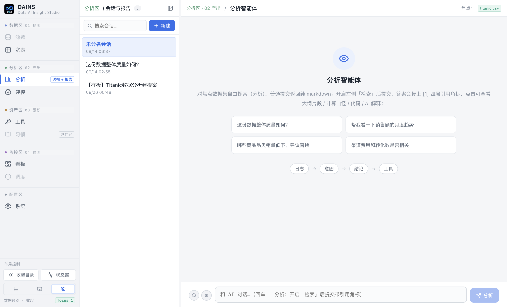

小贴士：在任意主功能页面**按住 Alt 键（macOS 为 Option）约 2 秒**，即可显示当前阶段各要素的功能说明。

## 九大板块：一个完整的分析闭环

九大板块构成完整的能力蓝图：**源数 → 宽表 → 分析 → 建模 → 工具 → 习惯 → 看板 → 调度 → 系统**。其中「习惯」「调度」仍在建设与规划中，下表按当前实际状态标注。

**1. 源数**（数据区）: 数据文件统一管理——上传、类型白名单、N 级目录树、焦点勾选跨板块联动。本地关系型数据库接入与外部数据 API 等扩展数据源仍在规划中。

**2. 宽表**（数据区）: 上传即透视——逐字段类型识别、缺失画像、15 箱直方图、Top10 高频取值，全量精确统计（非抽样），统计面板可一键导出独立 HTML 报告。

**3. 分析**（产出区）: 主菜——AI 问数。普通/检索式两种提交、HITL 意图确认、报告带四层支撑（结论/大纲/依据/代码）、HTML 与 PDF 导出。

**4. 建模**（产出区）: 两阶段 AutoML——Stage1 特征消融（看清「增益悬崖」）→ 人工或自动圈定特征 → Stage2 Optuna 超参搜索 → 建模报告；LightGBM 全自动调参，每一步可人工把关。

**5. 工具**（产出区）: 把套路沉淀下来——用自然语言描述分析逻辑，AI 提炼为**「输入 → 处理 → 输出」标准化工具**，换同构数据一键复用、纯 Python 执行、零大模型消耗。统计口径、行业惯例、惯用流程都这样固化下来。

**6. 习惯**（产出区｜**建设中**）: 规划用于沉淀您的口径——「统计结果保留两位小数」「方差分析前先做正态性检验」等个人偏好与统计约束，未来分析时自动召回，让每段结果带着您的约定出场。当前能力尚未完成。

**7. 看板**（监控区）: 从一问一答到持续浏览——一句话让**看板 Agent** 建好整块看板，19 种图表 + 6 种统计表、拖拽画布、数据由后端预计算秒开，生成只读链接免登录分享。

**8. 调度**（监控区｜**规划中**）: 未来将为整个系统注入「心跳」，承担周期性任务与看板内容的自动更新。当前尚未上线。

**9. 系统**（配置区）: 账户 / 配置 / 问卷——产品功能计划板、问卷收集、欢迎文档与使用文档。

| 宽表 · 上传即透视 | 分析 · HITL 意图确认 |
|---|---|
| 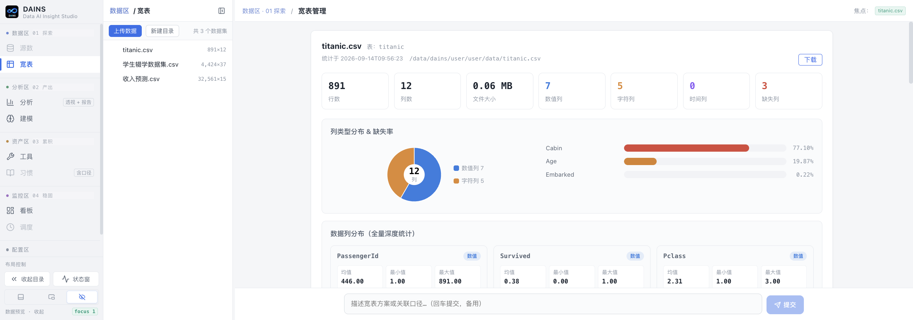 | 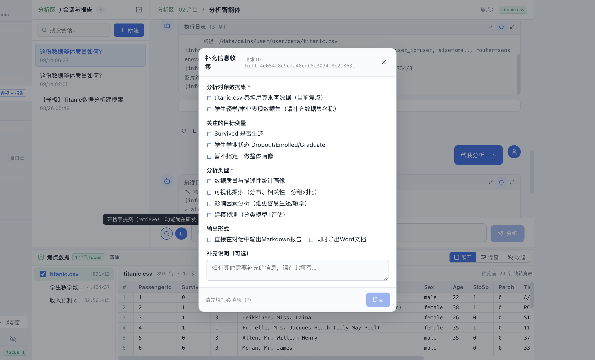 |

| 建模 · 两阶段参数盘 | 看板 · 拖拽画布 |
|---|---|
| 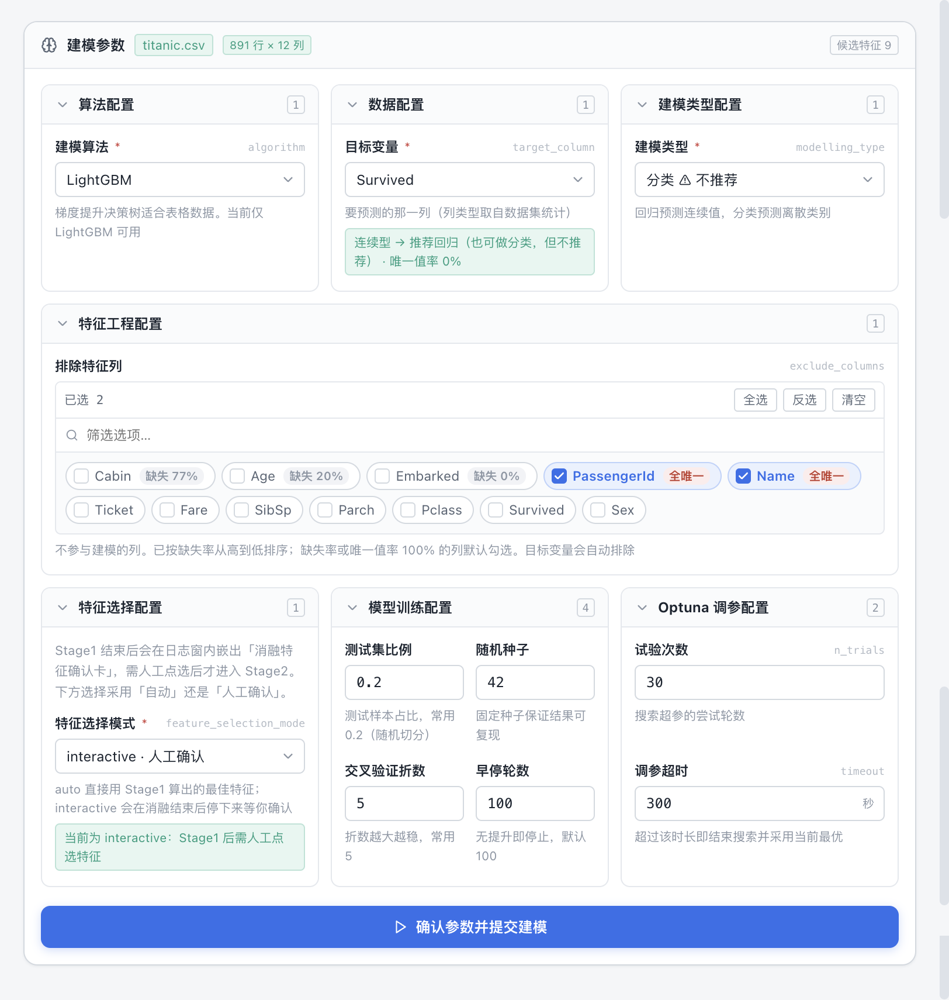 | 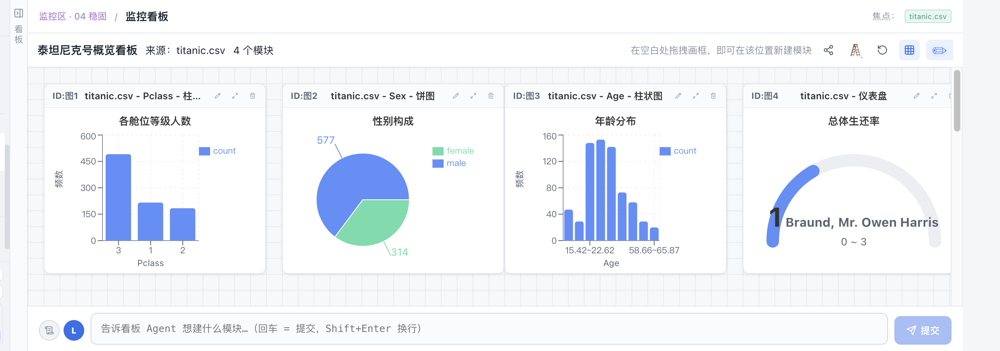 |

## 5 分钟上手（在线体验指引）

打开 **[dains.cn](https://dains.cn)** 注册登录后，推荐按这条路径走一遍：

**① 上传数据 → 宽表自动透视**
在【源数】上传任意 CSV / Excel（也可先用系统自带的 Titanic 样例），切到【宽表】：类型识别、缺失率、分布特征已经算好摆在面前，一行代码都不用写。

**② 对着数据提问 → 分析智能体**
切到【分析】，选定焦点数据集，用白话提问（例如「哪些字段对 Survived 影响最大？」「帮我看看销售额的月度趋势」）。Agent 弹出**意图确认卡**（HITL）帮您补全分析对象、目标变量与输出形式，确认后进入执行。

**③ 读懂答案 → 四位一体**
答案按「结论 · 大纲 · 依据 · 代码实证」组织：正文引用角标点击即可展开**该段结论实际执行的 Python 代码**与 AI 解释；支持导出 HTML（溯源）与 PDF（交付）。

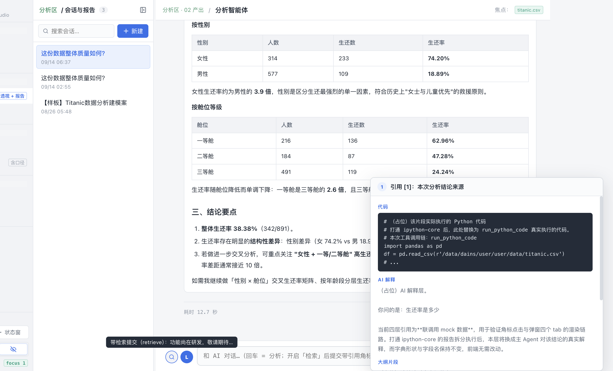

**④ 沉淀复用 → 工具**
把跑通的分析步骤存为**多步骤工具**，换一份焦点数据集原样复用；偏好与口径的自动召回能力将随【习惯】板块建成后提供。

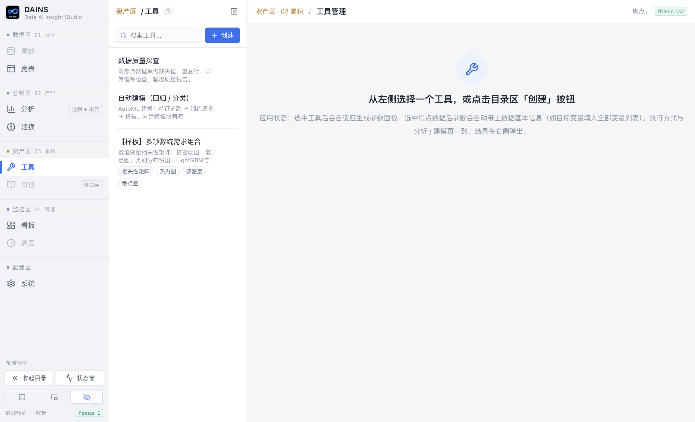

**⑤ 进入稳态 → 看板**
分析充分展开后，让**看板 Agent** 把结论组装成模块化看板（拖拽布局、19 种图表可选），生成只读链接分享给同事——免登录即可浏览。内容自动更新能力将随【调度】板块上线后提供。

## 一棵完整的分析流程树

从上传到稳态，一棵流程树看懂 DAINS 的完整能力链：

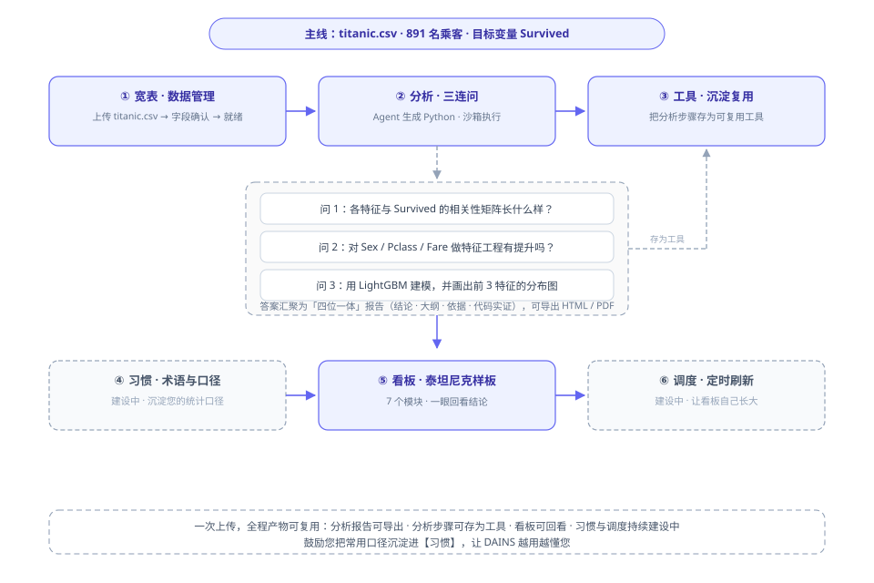

一次上传，全程产物可复用：**分析报告可导出 · 分析步骤可存为工具 · 看板可回看**。

## 产品架构

服务端采用 Docker Compose 架构部署，后端服务由 supervisor 统一管控，按职责划分为 API 服务、AI Agent、Python 沙箱、任务调度等单元；接入层由 Cloudflare Tunnel + NGINX 承担。配合 Ollama 本地模型即可组成全链路内网闭环；**面向用户的私有化交付包仍在路线图上**。

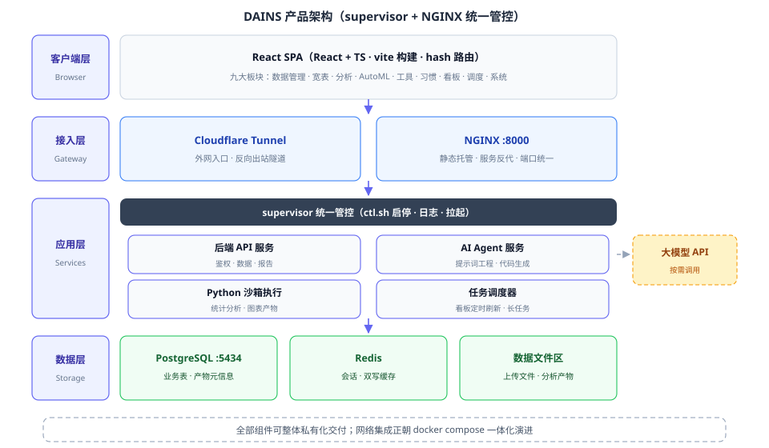

**网络链路**：浏览器 → Cloudflare Tunnel → NGINX → 后端服务 → 大模型 API。服务仅监听本机端口，隧道由内向外出站建连，**服务器无需暴露任何入站端口**；大模型 API Key 加密存放于服务端，仅在您发起分析时发送必要的统计摘要与提示词。

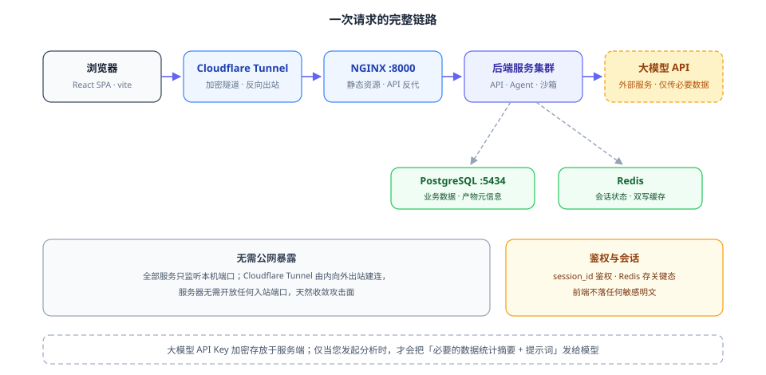

| 层 | 技术选型 |
|---|---|
| 客户端 | React + TypeScript + Vite |
| 接入层 | Cloudflare Tunnel + NGINX |
| 应用层 | Python Flask 多服务（supervisor 管控）|
| AI 层 | 多模型路由（国产模型为主）+ Python 沙箱真实执行 |
| 数据层 | 文件系统 + PostgreSQL + Redis |
| 建模 | LightGBM + Optuna（两阶段 AutoML）|

## 大模型接入：一个 Router，多种供应商

DAINS 不绑定任何一家大模型，所有推理请求统一经过一层 LLM Router，按能力、成本与时延分发到最合适的服务。当前**以国产模型为主**：

- **云端（国产为主）**：DeepSeek、通义千问、Kimi、智谱、火山方舟等，以及 SiliconFlow（硅基流动）、OpenRouter 等聚合中转；
- **本地**：Ollama（计划加入 Xinference），数据不出机器、零 API 费用、离线可用；
- **接入标准**：Router 采用 **OpenAI 兼容协议**作为统一接口（Anthropic 协议适配中）。这里的「OpenAI / Anthropic」指的是**接口标准，而非特定厂商**——就像 Type-C 只是一个接口规范，国内许多模型服务尚未来得及单独开发适配，只要符合 OpenAI 兼容标准，都可以直接接入试用。

模型可以更换、可以混用、也可以降级到更经济的方案，而分析流程、工具与口径资产不受影响。选 Ollama 路线，整条链路——上传、解析、统计、建模、成文——全部在您的机器内闭环，数据无需发往公网，零 token 费用、离线可用。

## 数据隐私与安全

从上传到删除，数据的每个停留点都**可见、可查、可清**：

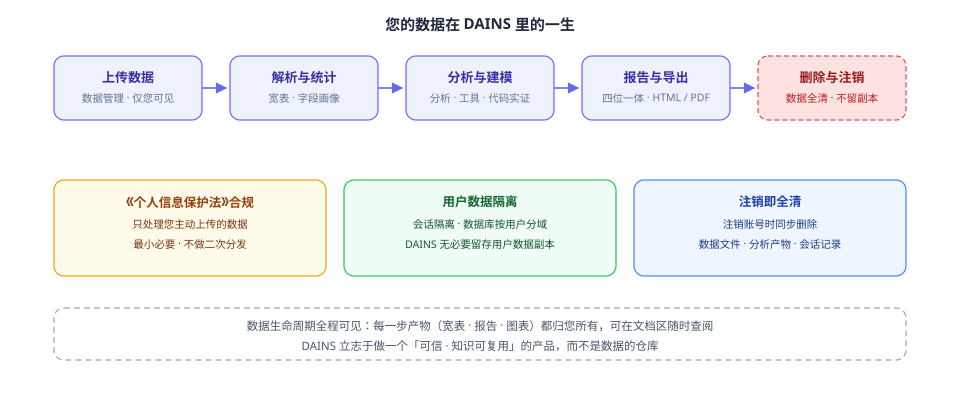

**您的数据只暂存于三处**：文件系统（上传文件与分析产物）、PostgreSQL（业务元信息）、Redis（会话状态），除此之外无任何副本。注册所需的账号信息（用户名、邮箱、加密后的登录凭据）保存在平台数据库中，仅用于登录与账号管理。

> **⚠️ 数据隐私承诺**
>
> DAINS 遵循《个人信息保护法》等法规处理数据，且无必要留存用户任何数据——分析在您的数据上就地完成，产物归您所有，**唯一例外是问卷收集信息，仅用于产品改进**。
>
> 注销账号即触发**全清**：注册信息（账号及关联加密凭据）、数据文件、分析产物、会话记录一并删除，不留残余。

> **⚠️ 看板分享提示**：看板生成的只读分享链接为**免登录访问**，任何持有链接者均可查看该看板内容；分享前请确认看板中不含敏感数据。

> **🔵 AI 生成内容标识**：平台按《人工智能生成合成内容标识办法》对 AI 生成的文本、图表与报告添加生成标识；您在对外使用导出报告时，请同步留意所在场景的标识要求。

> **🔵 协议与政策**：《用户协议》与《隐私政策》整理中，将在注册页提供并需勾选同意，其中会明确数据留存范围、注销清除流程与双方权责。

## 当前状态与测试说明

- 当前版本为**能力预览版（Beta，公测期）**，以线上方式提供服务；产品级私有化交付（Windows 桌面版 / Docker Compose）是未来明确的落地方向。
- **开放时间**：每天 8:30 – 23:10。测试阶段由本地服务器部署、Cloudflare 做网络中转，**高峰时段可能遇到卡顿甚至短时无法访问**；正式交付版本无需跨网传输，不存在此类卡顿问题。
- 没有自己的大模型 API Key？测试密钥**限量领取**，需要的评论或私信博主。密钥为公共共享资源，已设置用量与频率限制，仅限公测体验使用，请勿用于生产任务或批量调用。
- 能力预览版按「现状」提供，不承诺服务连续性；**重要分析结果请及时导出留存**。
- AI 生成的统计结论仅供决策参考，正式用途请以人工复核后的结果为准。
- 建议先用系统自带的 Titanic 样例或**脱敏数据**体验；上传真实业务数据前，请先阅读上文的隐私承诺与看板分享提示。

*本文档最后更新：2026-11-08*

## 路线图

| 方向 | 内容 |
|---|---|
| **看板与自动化** | 图表体系完善、调度板块、定时跑批与异动叙事播报 |
| **数据接入与宽表** | 多表关联、NL2SQL 与上游数据接入、轻量 ETL |
| **分析 Agent 深化** | 长任务拆解执行、口径召回、交叉验证与大模型审核机制、R 语言支持 |
| **工具与资产生态** | 工具市场与方案模板包、统一资产抽象（工具 / 口径 / 看板 / 调度）|
| **产品化交付** | Docker Compose 私有化、Windows 打包分发、License 授权体系 |

> 看板 Agent、只读分享与导出已上线，不再列为规划项。逐条可追溯的进度见系统内【产品功能计划板】。

## 反馈与问卷

**2027 年前，DAINS 不考虑任何盈利，最关心的是用户问卷。**

DAINS 由独立开发者以 OPC（One Person Company，一人公司）方式从零打造，产研链条上难免存在不够成熟之处：部分延展方向受限于个人精力尚未展开，实际使用中也可能遇到各类缺陷（Bug）。无论您是想提出建议，还是发现了问题，都欢迎通过【系统】→【问卷收集】告诉我们，每一条都会被认真对待、逐条跟进。

诚挚邀请您花三分钟填写问卷：登录 [dains.cn](https://dains.cn) 后，进入左侧【系统】板块的【问卷收集】。功能期待、使用障碍、建议与意见，都是产品演进的第一手依据——您的每一条反馈都会进入产品功能计划板。

图文版产品介绍与公测说明，请见[《Data Insight Studio 公测招募》](https://blog.csdn.net/Tigflanker/article/details/169844744)；更细的功能说明见 **[产品文档 Wiki](https://wiki.dains.cn)**。

感谢您试用 DAINS：愿每一次分析，都**可信、可复用、可沉淀**。

## License

© 2026 DAINS. All Rights Reserved.

本项目为闭源软件，本仓库不含任何源代码；未经授权，请勿将本仓库中的文案与图片用于商业用途。

**[dains.cn](https://dains.cn) —— 上传一份数据，开始第一次对话式分析**

